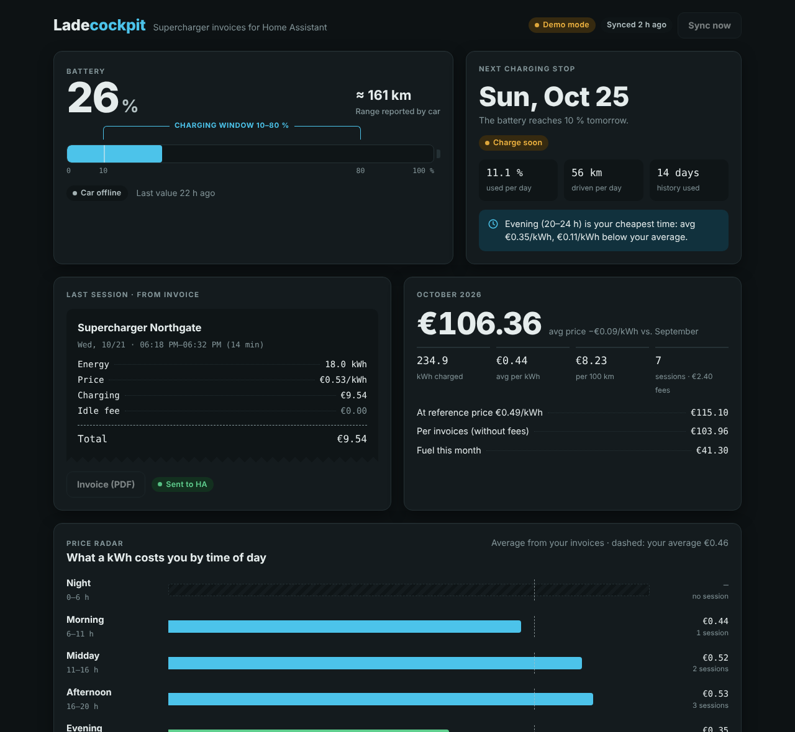

# Ladecockpit

**Your real Supercharger invoices in Home Assistant – plus a small web app that shows what charging actually costs you.**

[Deutsch](README.de.md)



Most Home Assistant setups estimate Supercharger costs from the car's kWh and a fixed price, or ask you to type the price in after every session. Ladecockpit fetches the actual invoice from the Tesla Fleet API instead (billed kWh, price per kWh, idle fees, site, PDF) and hands it to Home Assistant.

## Features

- **Exact invoices, automatically.** Ladecockpit notices the end of a session, picks up the invoice within minutes and sends it once to Home Assistant. A blueprint books it into your own helpers.
- **Price radar.** Shows, from your own invoices, which time of day and which Supercharger is cheapest for you.
- **MultiPass.** Third-party chargers paid through Tesla MultiPass are recognised in the Tesla invoices and shown separately, with their own average price.
- **Next charging stop.** Forecasts when the battery reaches your floor (default 10 %) based on your recent consumption, and tells you when and where to charge before that: the cheapest combination of Supercharger and time of day from your own invoices.
- **Monthly view.** Cost, kWh, average price, cost per 100 km/mi, optional comparison with a reference price or the fuel cost of another car.
- **Savings vs. a combustion car.** What the same distance would have cost with petrol or diesel (fixed values or live from Home Assistant, e.g. a fuel price sensor), per month and projected for a year.
- **Monthly report.** On the first of the month a summary of the previous month as an event and a notification in Home Assistant.
- **Tesla credits handled correctly.** Sessions partly paid with Tesla credits (e.g. free Supercharging with a new car) show what you paid, the list price and the credit. Price comparisons use the list price, so a credit never makes a Supercharger look cheap.
- **Charging at home.** With the energy meter of your wallbox and your electricity price (also dynamic tariffs), cost per 100 km/mi and the savings include charging at home.
- **Battery health.** Range at 100 % over time, from the readings Ladecockpit keeps anyway, and the Supercharger share of your charging.
- **Consumption by outside temperature.** How much more battery your car uses when it is cold.
- **Monthly PDF.** A cover sheet with all sessions (net, VAT, gross, credits) plus all invoices of a month in one PDF – for tax or your employer.
- **Charging power and efficiency.** Average kW per session and per Supercharger, kWh per 100 km/mi including charging losses.
- **Reconciliation.** Compares your Home Assistant totals with the invoices.
- **Export.** All sessions as CSV, all invoices of a month as one ZIP file.
- **Problem alerts.** A notification in Home Assistant when the Tesla sign-in expired or syncing keeps failing.
- **Sensors for your dashboard.** Next charging stop, battery, monthly cost, last session and price tip as Home Assistant entities, with a ready-made dashboard section.
- **Works while the car is offline.** Keeps its own history of battery level and odometer, e.g. for a car parked without reception.
- **Cheap on the Tesla API.** Live data comes from Home Assistant. Tesla is only asked for the charging history, a few dozen requests per month.
- **Read-only.** There is no code that sends commands to the car or wakes it.
- **Runs as a Home Assistant app** (sidebar, no extra server) or as a Docker container anywhere.
- English and German, demo mode without any credentials, installable on the phone's home screen.

## How it works

```
Home Assistant ──(battery, odometer, charging state)──► Ladecockpit ──(charging history)──► Tesla Fleet API
      ▲                                                     │
      └──────── event "ladecockpit_invoice" ◄───────────────┘
                (blueprint books kWh + cost into your helpers)
```

1. Ladecockpit polls a few entities of your car in Home Assistant (local, free) every minute.
2. When the charging state leaves `charging`, it asks Tesla for the charging history every 10 minutes until the new invoice is there (at most 3 hours). Otherwise it syncs every 6 hours.
3. Each new invoice is sent exactly once as the event `ladecockpit_invoice`.
4. On the very first sync, all past invoices are only imported (shown in the app) and **not** sent, so totals you already keep in Home Assistant are not counted twice.

## Requirements

- Home Assistant OS or Supervised (for the app), **or** Docker on any machine that runs 24/7
- A Tesla account and a **Tesla developer app** with Fleet API access
- Optional but recommended: Home Assistant with an integration that exposes your car's entities (Tesla Fleet, Teslemetry, Tessie, …)

## Install as Home Assistant app (recommended)

[](https://my.home-assistant.io/redirect/supervisor_add_addon_repository/?repository_url=https%3A%2F%2Fgithub.com%2Fuekala%2Fladecockpit)

1. Click the button above, or add `https://github.com/uekala/ladecockpit` under Settings → Apps → App store → ⋮ → Repositories.
2. Install **Ladecockpit**, enter your Tesla client ID/secret and your car's entities on the **Configuration** tab, and start it.
3. Open **Ladecockpit** in the sidebar and follow the three sign-in steps shown there.
4. Book the invoices with the blueprint (see [step 5](#5-book-invoices-in-home-assistant)).

Run only one Ladecockpit at a time. Two instances would report every invoice twice. The [app documentation](ladecockpit-app/DOCS.md) has the details.

## Quick start with Docker (demo)

```bash
git clone https://github.com/uekala/ladecockpit.git
cd ladecockpit
cp .env.example .env
docker compose up -d --build
```

Open `http://localhost:8077`. Without credentials the app runs with example data.

## Setup

### 1. Tesla developer app

If you already use the Tesla Fleet integration in Home Assistant (or another Fleet API tool) with your own developer app, you can reuse it:

1. On [developer.tesla.com](https://developer.tesla.com) open your app.
2. Add `http://localhost:8077/auth/callback` to **Allowed Redirect URIs**.
3. Make sure the scope **Vehicle Charging Management** is enabled. Tesla bundles the charging history and charging commands in this scope. Ladecockpit only reads.
4. Note the client ID and secret.

Starting from scratch? The Fleet API only answers apps whose domain is registered with a public key. The [Home Assistant Tesla Fleet documentation](https://www.home-assistant.io/integrations/tesla_fleet/) walks through creating the app and registering the key. Tesla's own steps are in the [Fleet API docs](https://developer.tesla.com/docs/fleet-api).

### 2. Configure

```bash
cp .env.example .env
```

Minimum: `TESLA_CLIENT_ID`, `TESLA_CLIENT_SECRET`, `HA_URL`, `HA_TOKEN` (Home Assistant → Profile → Security → Long-lived access tokens) and your car's entities:

| Setting | Example | Unlocks |
|---|---|---|
| `HA_ENT_SOC` | `sensor.my_tesla_battery_level` | battery card, forecast |
| `HA_ENT_RANGE` | `sensor.my_tesla_battery_range` | range |
| `HA_ENT_ODOMETER` | `sensor.my_tesla_odometer` | distance per month, cost per 100 km/mi |
| `HA_ENT_CHARGING` | `sensor.my_tesla_charging` | invoice right after a session ends |
| `HA_ENT_FUEL_CONSUMPTION` / `FUEL_CONSUMPTION`, `HA_ENT_FUEL_PRICE` / `FUEL_PRICE` | `7.5`, `sensor.fuel_price` | savings vs. a combustion car |
| `HA_ENT_HOME_ENERGY`, `HA_ENT_HOME_PRICE` / `HOME_PRICE` | `sensor.wall_connector_energy`, `0.32` | charging at home |
| `HA_ENT_OUTSIDE_TEMP` | `weather.home` | consumption by temperature |

Use the IP of Home Assistant in `HA_URL`. `.local` names often do not resolve inside containers. All settings are listed in [.env.example](.env.example).

### 3. Run

```bash
docker compose up -d --build
docker compose logs -f      # expect "Ladecockpit … started (live, …)"
```

Or use the published image (see `docker-compose.yml`): `ghcr.io/uekala/ladecockpit:latest` for amd64 and arm64.

### 4. Connect to Tesla

Open `http://localhost:8077` on the machine running the container and click **Sign in with Tesla**. The first sync starts right after.

The redirect URI points to `localhost`. If the container runs elsewhere, either open an SSH tunnel (`ssh -L 8077:localhost:8077 your-server`) or copy the full address from the browser bar after signing in (the page itself will not load) and paste it under "The redirect after sign-in does not land here?".

### 5. Book invoices in Home Assistant

1. Create two **Number** helpers (Settings → Devices & services → Helpers), e.g. "Charging energy total" (kWh) and "Charging cost total". Set the **maximum high** (e.g. 1000000), the default of 100 is reached quickly. Optionally add a **Text** helper for the last session.
2. Import the blueprint:

   [](https://my.home-assistant.io/redirect/blueprint_import/?blueprint_url=https%3A%2F%2Fgithub.com%2Fuekala%2Fladecockpit%2Fblob%2Fmain%2Fblueprints%2Fautomation%2Fladecockpit%2Fbook_invoice.yaml)

3. Create an automation from it and pick your helpers. Under *Additional actions* you can add a notification. The variables `site`, `kwh`, `total`, `price_per_kwh`, `idle_fee`, `currency`, `network` and `text` are available there.
4. Set `HA_ENT_COST_TOTAL` and `HA_ENT_KWH_TOTAL` to the two helpers to see the reconciliation in the app.

Optional: [`homeassistant/ladecockpit_package.yaml`](homeassistant/ladecockpit_package.yaml) adds a `rest_command` to trigger the invoice lookup yourself.

### 6. Sensors and dashboard

Ladecockpit creates these entities in Home Assistant itself (switch off with the app option `publish_entities` or `PUBLISH_ENTITIES=false`):

| Entity | State | Useful attributes |
|---|---|---|
| `sensor.ladecockpit_next_charge` | date of the next charging stop | `text`, `days`, `plan` (when and where to charge), `plan_saving` |
| `sensor.ladecockpit_battery` | battery level in %, the last known value while the car is offline | `range`, `last_known`, `as_of` |
| `sensor.ladecockpit_month_cost` | charging cost this month | `energy_kwh`, `price_per_kwh`, `cost_per_100`, `kwh_per_100`, `multipass_cost`, `savings`, `projected_year_cost`, `previous_cost` |
| `sensor.ladecockpit_last_charge` | cost of the last session | `network`, `site`, `energy_kwh`, `price_per_kwh`, `avg_power_kw`, `text` |
| `sensor.ladecockpit_price_tip` | your cheapest time of day, as a sentence | `best_time`, `best_site`, `insights` |
| `sensor.ladecockpit_range_at_100` | range at 100 % (long-term statistics) | `change_pct`, `since`, `supercharger_share` |
| `sensor.ladecockpit_consumption` | billed kWh per 100 km/mi this month | `by_temperature`, `temperature_tip` |
| `binary_sensor.ladecockpit_problem` | `on` when the Tesla sign-in expired, syncing fails or an entity is missing | `kind`, `message`, `last_sync` |

They are written through the REST API and have no unique ID, so they cannot be renamed in the UI. After a Home Assistant restart they are back within a few minutes. A ready-made dashboard section is in [`homeassistant/dashboard_card.yaml`](homeassistant/dashboard_card.yaml).

## Event data

`ladecockpit_invoice` carries:

| Field | Example |
|---|---|
| `session_id` | `"1234567"` |
| `site` | `"Northgate"` |
| `start`, `end` | ISO timestamps in your time zone |
| `kwh` | `18.0` (billed) |
| `charge_cost`, `idle_fee`, `total` | `6.66`, `0.0`, `6.66` |
| `price_per_kwh` | `0.37` |
| `currency` | `"EUR"` |
| `network` | `"supercharger"` or `"multipass"` |
| `text` | `"18.0 kWh · €6.66 · €0.37/kWh · Oct 21, 18:18"` |

## Monthly report

On the first of each month Ladecockpit fires `ladecockpit_month_report` with the previous month: `label`, `sessions`, `kwh`, `cost`, `price_per_kwh`, `distance`, `cost_per_100`, `kwh_per_100`, `multipass_cost`, `idle_fees`, `fuel_equivalent`, `savings`, `title` and `text` (a ready sentence). With the option `month_report` / `MONTH_REPORT` it also creates a notification in Home Assistant. To get it on your phone:

```yaml
triggers:
  - trigger: event
    event_type: ladecockpit_month_report
actions:
  - action: notify.mobile_app_your_phone
    data:
      title: "{{ trigger.event.data.title }}"
      message: "{{ trigger.event.data.text }}"
```

## MultiPass

Tesla bills MultiPass sessions (third-party chargers paid through your Tesla account) through the same charging history as Supercharger sessions. The Fleet API has no field that names the network, and Tesla has not documented how these sessions look. Ladecockpit therefore goes by hints: a billing or invoice type other than the one Supercharger sessions have, words like "roaming" or "partner" in Tesla's fields, or the name of a known operator (IONITY, EnBW, Fastned, …) in the site name. The rule is applied whenever sessions are read, so an improved rule in a later version also re-classifies older sessions.

If a MultiPass session is shown as Supercharger (or the other way round), please open an issue with the anonymised output of `/api/debug/raw` for that session. The log also notes fields Ladecockpit does not know yet.

## API

| Path | Purpose |
|---|---|
| `/` | Web app |
| `GET /api/dashboard` | Everything the web app shows, as JSON |
| `GET /api/ha` | Flat values for REST sensors |
| `POST /api/sync` | Look for a new invoice at short intervals |
| `POST /api/sync/now` | Sync now |
| `GET /api/invoice/<id>` | Invoice PDF (cached locally) |
| `GET /api/invoices/<YYYY-MM>.zip` | All invoices of a month |
| `GET /api/report/<YYYY-MM>.pdf` | Cover sheet plus all invoices of a month in one PDF |
| `GET /api/export.csv` | All sessions as CSV |
| `GET /api/debug/raw` | Last raw Tesla response, to check field names |
| `GET /healthz` | Health check |

## Costs

The Fleet API is billed per request. Ladecockpit only uses data requests for the charging history and invoices. With default settings that is a few dozen requests per month, well inside the monthly credit Tesla gives every developer account. `API_BUDGET_REQUESTS` (default 1500) is a hard stop. The app shows the count of the current month.

## Privacy and security

- Everything stays on your machine: tokens, invoices and readings live in the Docker volume `ladecockpit-data` (SQLite and a PDF cache).
- Ladecockpit talks only to Tesla and your Home Assistant.
- Run it in your LAN or behind a reverse proxy with authentication. `APP_PASSWORD` adds simple HTTP Basic protection.
- Never commit your `.env`. It is already in `.gitignore`.

## Troubleshooting

- **"Entity not found in Home Assistant"**: check the `HA_ENT_…` settings in Developer tools → States.
- **Invoice amounts are 0 or missing**: open `/api/debug/raw` and compare the fields with what `app/tesla.py` reads. Please open an issue with an anonymised sample.
- **"Tesla sign-in expired"**: refresh tokens are single-use and expire after a while without use. Connect again.

## Development

```bash
python -m venv .venv && . .venv/bin/activate
pip install -r requirements.txt -r requirements-dev.txt
pytest
APP_MODE=demo uvicorn app.main:app --reload --port 8077
python -m scripts.build_preview preview.html    # standalone page with demo data
```

## Disclaimer

Ladecockpit is a community project and not affiliated with or endorsed by Tesla, Inc. Tesla and Supercharger are trademarks of Tesla, Inc. Use at your own risk and check your invoices in the Tesla app when in doubt.

## License

[MIT](LICENSE)
